<div align="center">


# AIROOM

**AIROOM: A Host-Configurable, Offline-First AI Network for Connectivity-Constrained Rooms in the Philippines**

### *Walang signal, may sagot.*

A private AI for the whole room, hosted on one computer, with no internet needed.

[](https://nextjs.org/)
[](https://react.dev/)
[](https://www.typescriptlang.org/)
[](https://tailwindcss.com/)
[](https://ollama.com/)
[](https://ai.google.dev/gemma)
[](#what-runs-locally-vs-what-needs-the-internet)
[](https://appbuildersph.com/hackathon)
[](LICENSE)

*One computer runs the AI. Every phone in the room joins its Wi-Fi and asks in the browser. No app, no account, no mobile data.*

</div>

---

## Table of Contents

<details>
<summary>Click to expand</summary>

1. [Overview](#overview)
2. [Background & Problem](#background--problem)
3. [What AIROOM Does](#what-airoom-does)
4. [Rooms: Make It Yours](#rooms-make-it-yours)
5. [Built for a Crowded Room](#built-for-a-crowded-room)
6. [In Times of Need](#in-times-of-need)
7. [Why Local](#why-local)
8. [What Runs Locally vs What Needs the Internet](#what-runs-locally-vs-what-needs-the-internet)
9. [System Architecture](#system-architecture)
10. [Tech Stack](#tech-stack)
11. [Project Structure](#project-structure)
12. [Getting Started](#getting-started)
13. [Screens](#screens)
14. [Disclosures](#disclosures)
15. [Team](#team)
16. [References](#references)
17. [License](#license)

</details>

---

## Overview

<div align="center">
  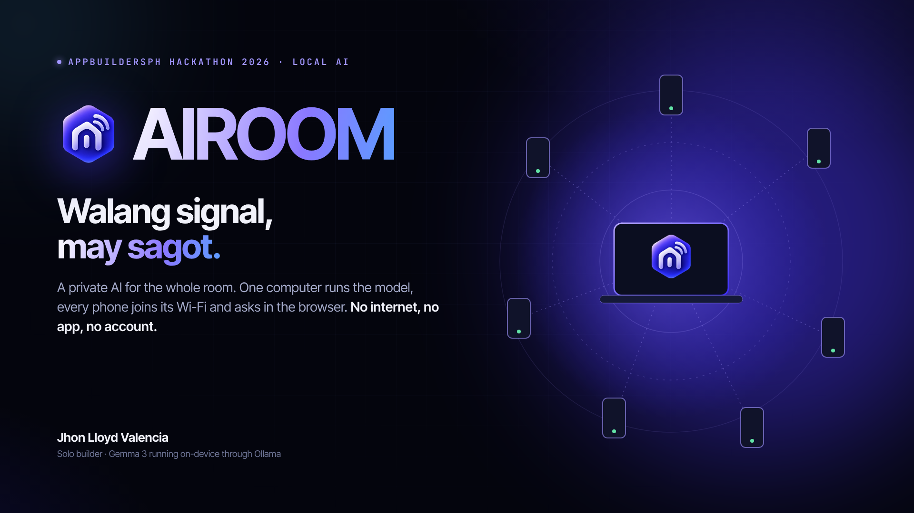
</div>

AIROOM turns one computer (a laptop or a desktop) into a private AI that everyone nearby can use. The computer runs Gemma 3 through Ollama and shares its Wi-Fi. People in the room scan a QR code, and the chat opens in their phone's browser.

It is **simple on the surface**: out of the box it is a general assistant for anyone in the room. It goes **deeper when it matters**: a host can turn the room into a *Room* with its own files and rules, it stays fair and private when the room is full, and in an emergency it puts safety first.

Built solo during the **AppBuildersPH Hackathon 2026** (theme: *Local AI*).

---

## Background & Problem

<div align="center">
  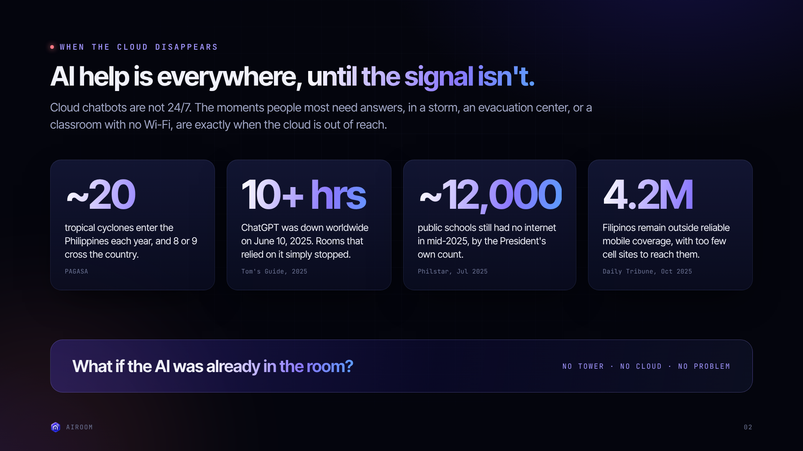
</div>

Cloud chatbots are not 24/7. The moments people most need answers, in a storm, an evacuation center, or a classroom with no Wi-Fi, are exactly when the cloud is out of reach.

- **~20** tropical cyclones enter the Philippine Area of Responsibility each year, and 8 or 9 cross the country (PAGASA).
- **10+ hours:** ChatGPT was down worldwide on June 10, 2025 (Tom's Guide).
- **~12,000** public schools still had no internet in mid-2025 (Philstar).
- **4.2 million** Filipinos remain outside reliable mobile coverage (Daily Tribune).

> What if the AI was already in the room?

---

## What AIROOM Does

<div align="center">
  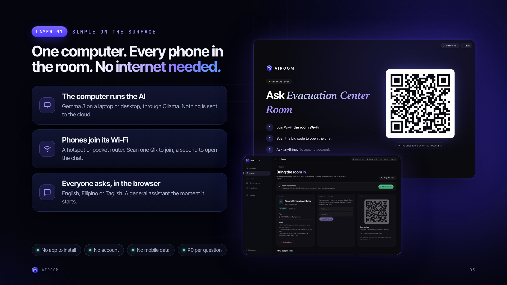
</div>

1. **The computer runs the AI.** Gemma 3 runs on the host through Ollama. Nothing is sent to the cloud.
2. **Phones join its Wi-Fi.** Use the computer's hotspot or a pocket router. One QR code joins the Wi-Fi, a second opens the chat. A projector view puts the join code on the wall.
3. **Everyone asks, in the browser.** English, Filipino or Taglish. No app to install, no account, no mobile data, and ₱0 per question.

The host runs the room from an **Assistant**: "create a class Room for Grade 9 Science" or "tell everyone the quiz starts at 2 PM". The Assistant shows a confirm card first, and nothing happens until the host clicks.

---

## Rooms: Make It Yours

<div align="center">
  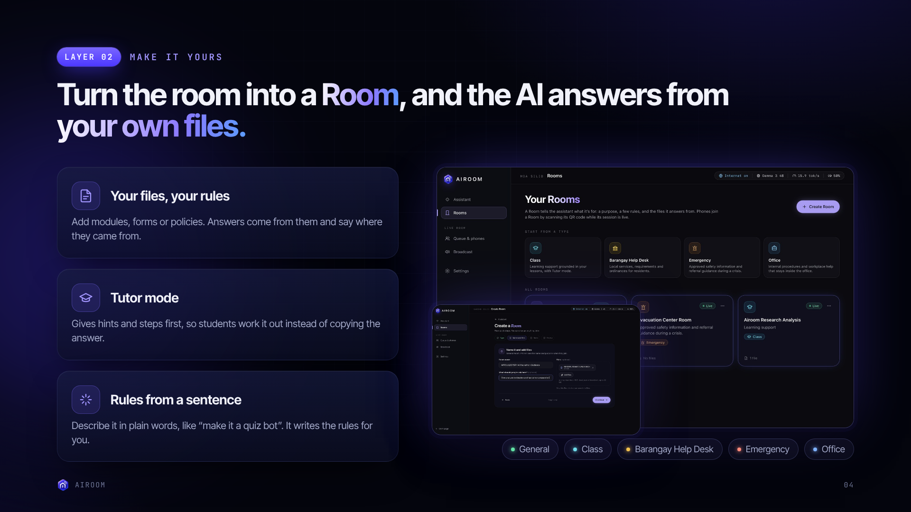
</div>

A **Room** tells the assistant what it is for: a purpose, a few rules, and the files it answers from. Creating one takes four steps (Type, Name and files, Rules, Review).

| Room type | For | Example question |
| --- | --- | --- |
| **General** | Anyone in the room. No setup needed. | "Explain photosynthesis simply" |
| **Class** | Learning support grounded in your lessons, with Tutor mode | "Help me solve 2x + 5 = 17" |
| **Barangay Help Desk** | Local services, requirements and ordinances | "Magkano ang barangay clearance?" |
| **Emergency** | Approved safety information and referral guidance during a crisis | "Saan ang relief distribution?" |
| **Office** | Internal procedures that stay inside the office | "How do I file vacation leave?" |

- **Your files, your rules.** Upload PDF, Word, text or Markdown (up to 20 MB). Answers come from them and say where they came from. Only that Room's chat can search its files.
- **Tutor mode.** Gives hints and steps first, so students work it out instead of copying the answer.
- **Rules from a sentence.** Describe it in plain words, like "make it a quiz bot", and AIROOM writes the rules. The host can edit them.

---

## Built for a Crowded Room

<div align="center">
  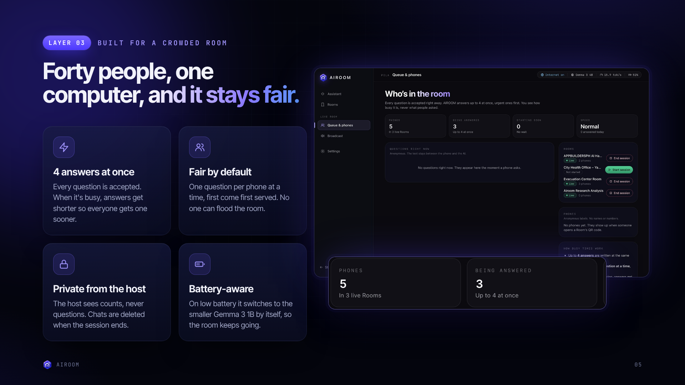
</div>

- **4 answers at once.** Every question is accepted right away. When the room is busy (more than 6 asking), answers get shorter so everyone gets one sooner.
- **Fair by default.** Each phone asks one question at a time, first come, first served, so nobody can flood the room.
- **Private from the host.** The host sees counts and anonymous labels, never what people asked. Chats are deleted when the session ends.
- **Battery-aware.** On low battery it switches to the smaller Gemma 3 1B by itself, so the room keeps going.

> The phone and answer counts on this slide were set for illustration.

---

## In Times of Need

<div align="center">
  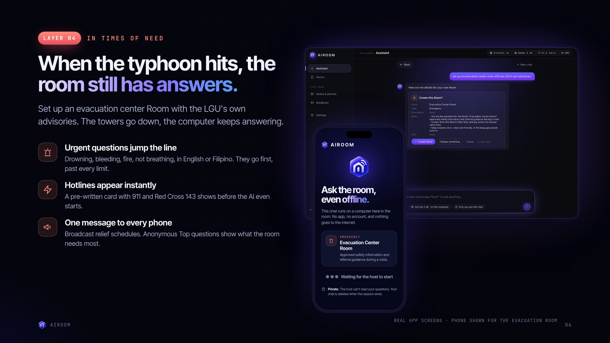
</div>

Set up an evacuation center Room with the LGU's own advisories. When the towers go down, the computer keeps answering.

- **Urgent questions jump the line.** Drowning, bleeding, fire, not breathing, in English or Filipino. They go first, past every limit.
- **Hotlines appear instantly.** A pre-written card with **911** and **Philippine Red Cross 143** shows before the AI even starts.
- **One message to every phone.** Broadcast relief schedules to everyone in the room.

---

## Why Local

<div align="center">
  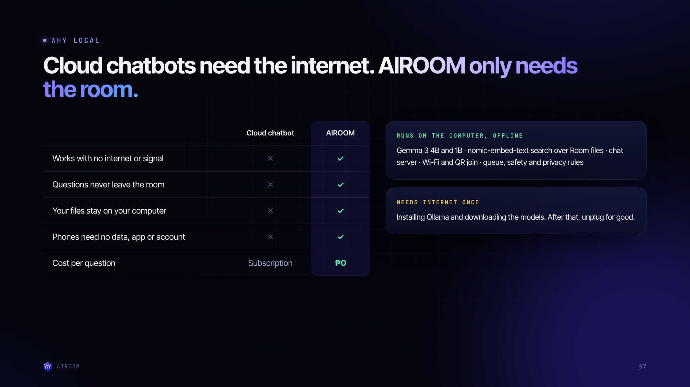
</div>

### Why does this product benefit from running AI locally?

Because the rooms that need help most are the ones the cloud can't reach. A classroom with no Wi-Fi, a barangay hall with weak signal, and an evacuation center after a typhoon all lose cloud AI at the exact moment they need it. AIROOM runs the model on a computer in the room, so it keeps answering through cloud outages, network blackouts and dead zones.

Running locally also means:

- **Privacy.** Questions and uploaded files never leave the room. The host can't read questions, and chats are deleted at the end of the session.
- **No cost per question.** Open models, no subscriptions and no API fees. Phones need no data plan.
- **No accounts.** Anyone can walk in, scan, and ask. That matters for residents, students and evacuees who may not have a login or a data load.

| | Cloud chatbot | AIROOM |
| --- | :---: | :---: |
| Works with no internet or signal | ✕ | ✓ |
| Questions never leave the room | ✕ | ✓ |
| Your files stay on your computer | ✕ | ✓ |
| Phones need no data, app or account | ✕ | ✓ |
| Cost per question | Subscription | ₱0 |

---

## What Runs Locally vs What Needs the Internet

| Runs on the host computer, offline | Needs the internet (once, during setup) |
| --- | --- |
| Gemma 3 4B chat, Room rules and the host Assistant | Installing Node.js and running `npm install` |
| Gemma 3 1B low-power fallback | Installing Ollama |
| `nomic-embed-text` embeddings and search over Room files | Pulling the three models (`ollama pull ...`) |
| PDF and Word text extraction | Running `npm run build` |
| The Next.js web app, API and phone chat | |
| Wi-Fi hotspot, QR codes and projector view | |
| Queue, urgent-first safety cards and privacy rules | |

After setup, unplug the internet for good. No prompts, files or chat data are sent to any online service.

---

## System Architecture

<div align="center">
  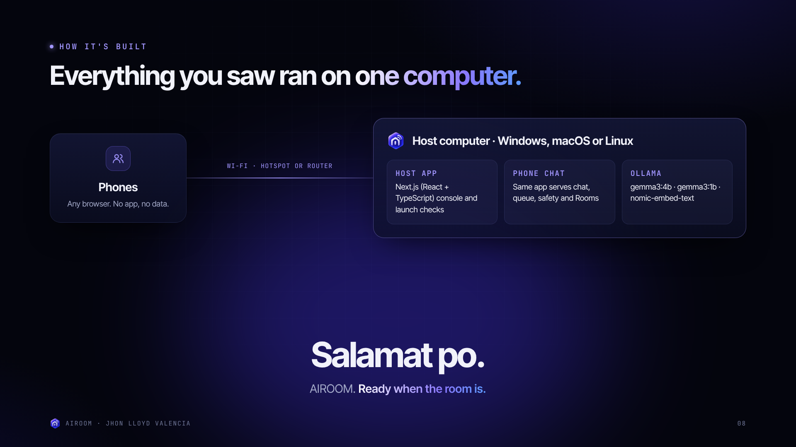
</div>

```
 Phones (any browser)                Host computer (Windows, macOS or Linux)
 ┌───────────────┐   Wi-Fi hotspot   ┌──────────────────────────────────────────────┐
 │ /r/[roomId]   │ ◄───────────────► │ Next.js app (0.0.0.0:3000)                   │
 │ phone chat    │   or pocket       │  ├─ /host     host console + Assistant       │
 └───────────────┘   router          │  ├─ /api/*    rooms, chat, queue, broadcasts │
                                     │  └─ data/     Rooms, files, chunks (JSON)    │
                                     │                    │                         │
                                     │                    ▼                         │
                                     │ Ollama (127.0.0.1:11434)                     │
                                     │  gemma3:4b · gemma3:1b · nomic-embed-text    │
                                     └──────────────────────────────────────────────┘
```

- The phone page streams answers from the Next.js API, which calls Ollama on the same computer.
- Room files are parsed (`unpdf`, `mammoth`), split into passages, embedded with `nomic-embed-text`, and searched per Room.
- `p-queue` keeps up to 4 answers running at once so the computer isn't overloaded.
- Launch checks confirm the hotspot, Ollama, the models, the firewall and memory on Windows, macOS and Linux.

---

## Tech Stack

| Layer | Technology |
| --- | --- |
| Web app and API | Next.js 16 (App Router), React 19, TypeScript 5 |
| Styling | Tailwind CSS 4 (compiled at build time), Inter Tight and JetBrains Mono (self-hosted) |
| State | Zustand |
| Local AI | Ollama with `gemma3:4b`, `gemma3:1b`, `nomic-embed-text` |
| Files | `unpdf` (PDF), `mammoth` (Word) |
| Queue | `p-queue` |
| Device info | `systeminformation` (battery, CPU, memory) |
| QR codes | `qrcode` |
| Storage | JSON files under `data/` (no database) |

---

## Project Structure

The app follows an MVC-style split inside `src/`:

```
src/
├── app/            Next.js routes only
│   ├── host/       Host console: Assistant, Rooms, Queue, Broadcast, Settings, Projector
│   ├── r/[id]/     Phone chat for a Room
│   └── api/        rooms, chat, queue, broadcasts, uploads, hotspot, launch checks, health
├── models/         TypeScript types for domain data (no React)
├── views/          pages/ for full pages, views/ for feature sections
├── controllers/    Hooks that connect views to services and state
├── state/          Zustand stores
├── services/       Ollama calls, file parsing and other server-side work
└── lib/            Shared constants and helpers (model names in lib/constants/models.ts)
scripts/            start-hotspot.ps1 / .bat (Windows hotspot helper)
data/               Runtime data, ignored by git
```

---

## Getting Started

### Prerequisites

- Node.js 20 or newer
- [Ollama](https://ollama.com) running on the host at `http://127.0.0.1:11434`
- A computer with 8 GB of RAM or more (16 GB recommended)

### Installation (while you still have internet)

```sh
# 1. Clone the repository
git clone https://github.com/jhonlloydval/AIROOM.git
cd AIROOM

# 2. Pull the models
ollama pull gemma3:4b         # main chat + vision (~3.3 GB)
ollama pull gemma3:1b         # low-power mode (~815 MB)
ollama pull nomic-embed-text  # embeddings for documents (~274 MB)

# 3. Install and build
npm install
cp .env.example .env.local    # optional; defaults work for a local Ollama
npm run build
```

### Run (offline from here)

```sh
npm run start    # production, listens on 0.0.0.0:3000
# or
npm run dev      # development
```

1. Turn on the computer's Mobile Hotspot (on Windows, `scripts/start-hotspot.bat` can help).
2. Open `http://localhost:3000` on the host, create or open a Room, and start the session.
3. Phones join the Wi-Fi and scan the Room's QR code. On Windows the hotspot address is usually `192.168.137.1`.
4. Allow Node.js on private networks if the firewall asks.

Check `http://localhost:3000/api/health` to confirm Ollama is reachable and every model is pulled. It returns `ok`, `degraded` (a model is missing) or `down`.

| Variable | Default | Purpose |
| --- | --- | --- |
| `OLLAMA_HOST` | `http://127.0.0.1:11434` | Where the app reaches Ollama. Keep it on the host. |
| `NEXT_PUBLIC_LAUNCH_CHECKS` | on | Set to `off` to skip the launch readiness checks |

---

## Screens

Real screens from the running app.

<div align="center">
  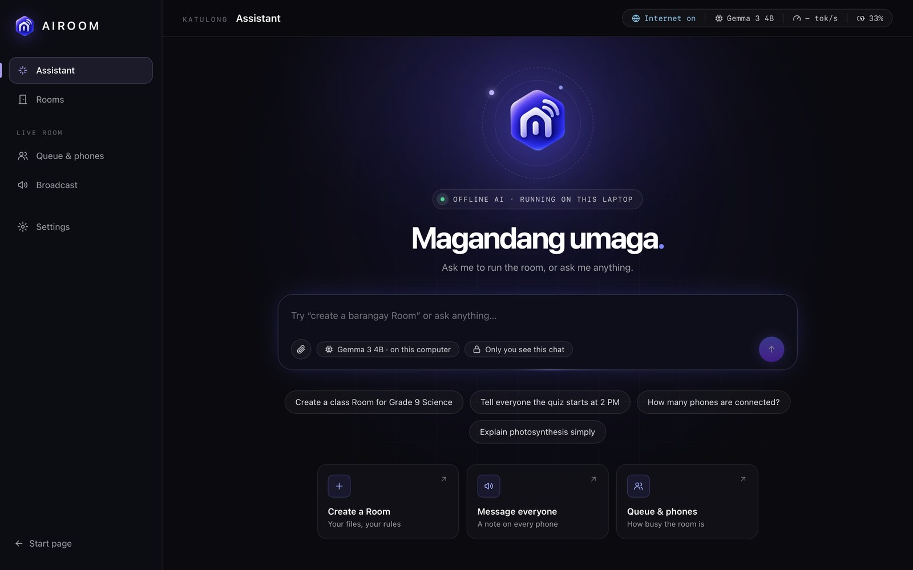
  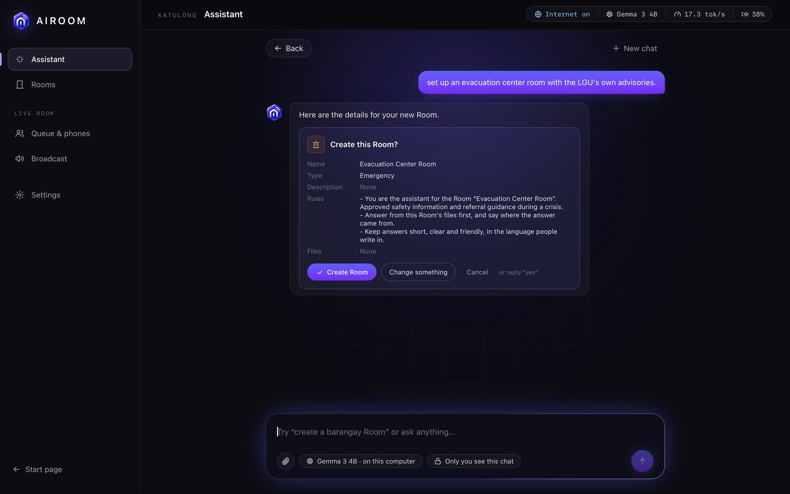
  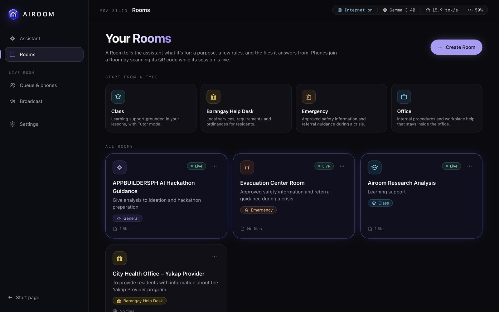
  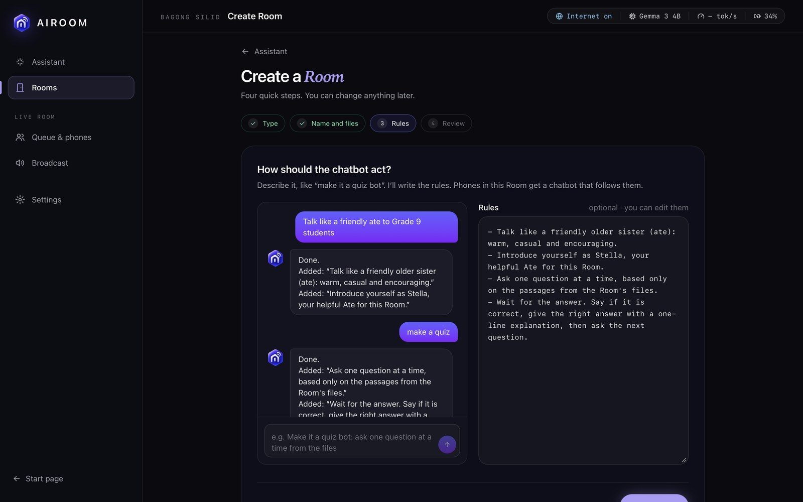
  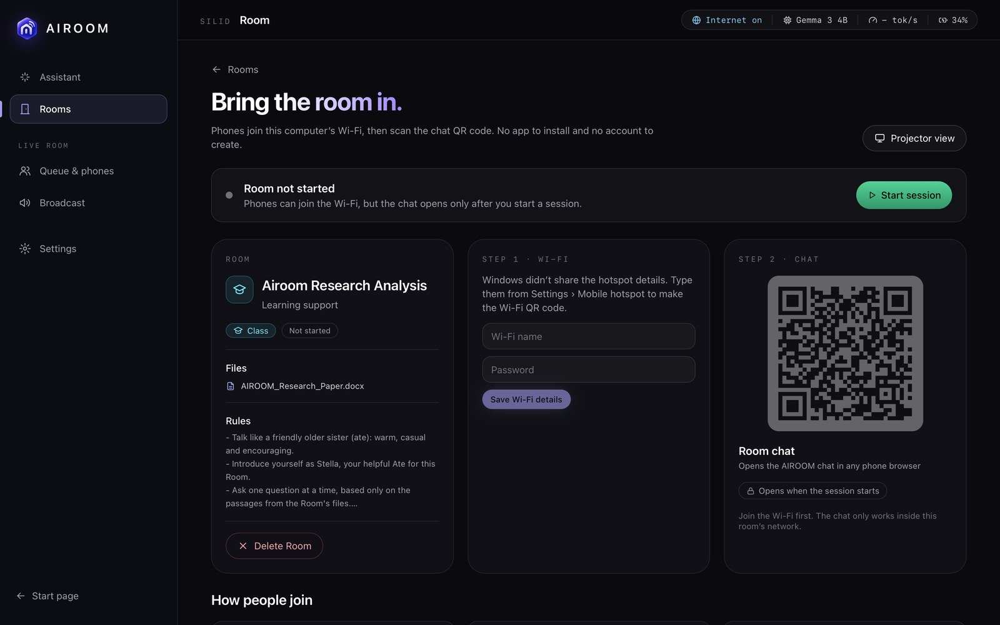
  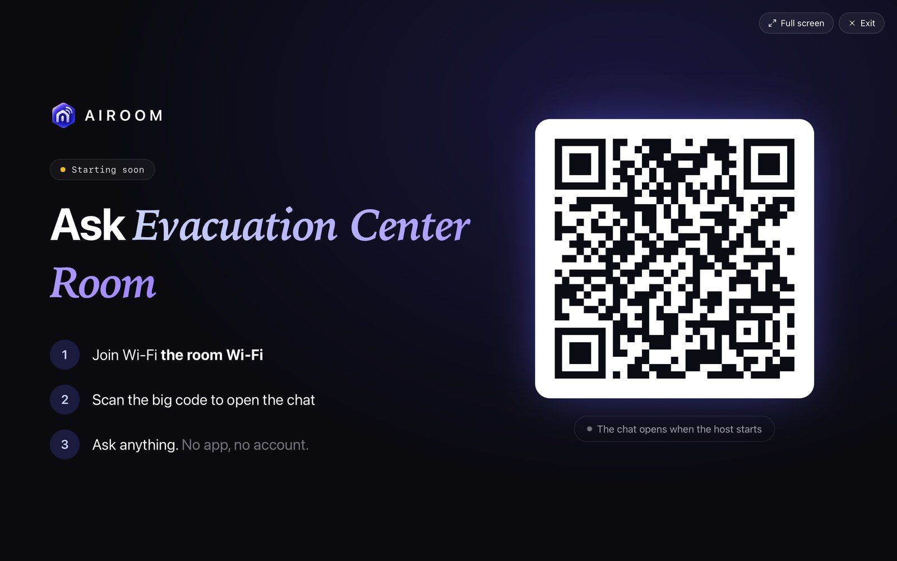
</div>

---

## Disclosures

Full list in [DISCLOSURE.md](DISCLOSURE.md).

- **AI models (local, through Ollama):** `gemma3:4b` and `gemma3:1b` (Google, Gemma Terms of Use), `nomic-embed-text` (Nomic AI, Apache 2.0).
- **Frameworks:** Next.js, React, TypeScript, Tailwind CSS, Zustand, Node.js, Ollama.
- **Libraries:** `ollama`, `unpdf`, `mammoth`, `qrcode`, `adm-zip`, `systeminformation`, `p-queue`.
- **APIs / cloud services:** none at runtime. The internet is used only to install dependencies and download models.
- **Existing code and assets:** none from before the hackathon. Fonts are Inter Tight and JetBrains Mono (SIL Open Font License, via Fontsource).
- **AI development tools:** parts of the code, documentation and this README were written with help from Claude (Anthropic) through Claude Code. The builder reviewed and is responsible for everything that ships.

---

## Team

| Name | Role |
| --- | --- |
| **Jhon Lloyd Valencia** | Solo builder: product, design, engineering |

---

## References

- PAGASA. *Tropical Cyclone Information.* https://bagong.pagasa.dost.gov.ph/climate/tropical-cyclone-information
- Tom's Guide (2025, June 10). *ChatGPT and OpenAI down: live updates.* https://www.tomsguide.com/news/live/chatgpt-openai-down-outage-6-10-2025
- Philstar (2025, July 28). *Marcos vows internet access for all public schools by end of 2025.* https://www.philstar.com/headlines/2025/07/28/2461427/marcos-vows-internet-access-all-public-schools-end-2025
- Daily Tribune (2025, October 5). *PHL acceleration in Asia's digital race pushed.* https://tribune.net.ph/2025/10/05/phl-acceleration-in-asias-digital-race-pushed

---

## License

Released under the [MIT License](LICENSE).

<div align="center">


**AIROOM** · Ready when the room is.

</div>
